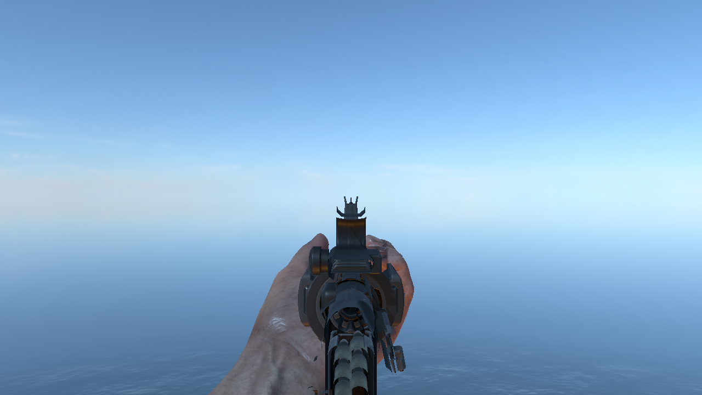
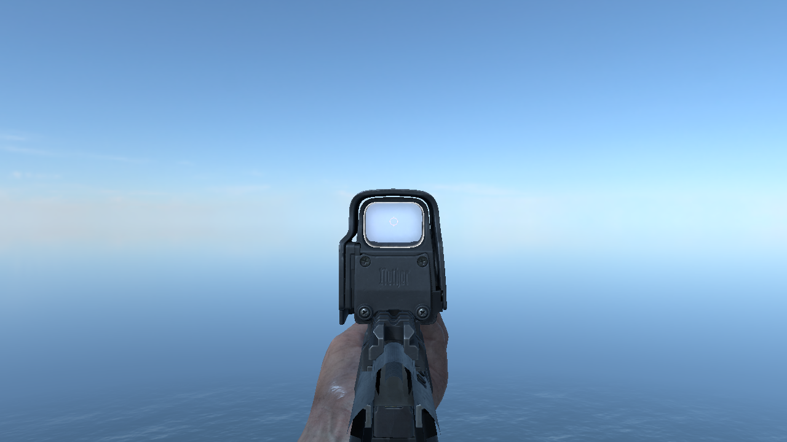
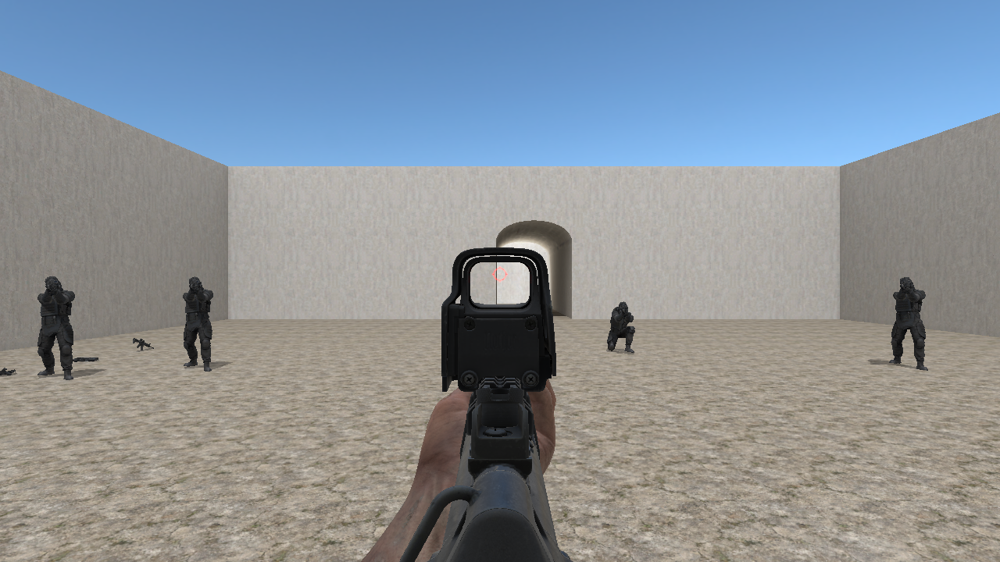
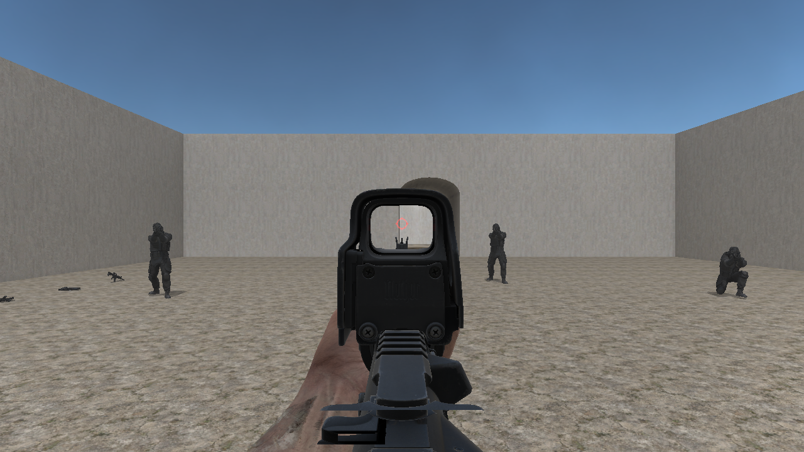

# M4A1 et accessoires d'armes

## M4A1 Facepunch

Placer `Assets/weapons/m4a1/m4a1.prefab` dans une scène puis ramasser l'arme.
Elle reprend `VBCombatWeapon`, le ramassage/drop, l'inventaire, les animations,
le HUD, les restrictions de traversée et les alertes de munitions existants.

| Réglage initial | Valeur |
|---|---:|
| Chargeur / réserve initiale | 30 / 60 |
| Munitions | `ammo/large.ammo`, réserve maximale 120 |
| Cadence automatique | 700 coups/minute |
| Dégâts | 25 |
| Rechargement | 2,6 s |
| Encombrement | 4 |

M4A1 + pistolet utilise les cinq points de capacité. Les SMG gardent leur
réserve `medium`, indépendante du fusil. Ces valeurs se règlent dans le prefab.

Les modèles officiels [ViewModel M4A1](https://sbox.game/facepunch/v_m4a1) et
[WorldModel M4A1](https://sbox.game/facepunch/w_m4a1) sont tous deux de Facepunch.
Le FPS utilise son propre animgraph et les bras humains officiels en bone merge.
Les bodygroups natifs sont conservés : chargeur, poignée de transport, caches
du garde-main et guidon haut. Les prefabs déclarent les références cloud.

`sounds/weapons/m4a1/fire.sound` réutilise provisoirement l'échantillon local
P90, avec volume et hauteur fixes ; remplacer son échantillon pour un son M4 dédié.

## Viseur holographique MP5

Les trois prefabs MP5 contiennent maintenant **Optic - Holographic (Attachment)**,
avec le modèle officiel [Sight Holographic](https://sbox.game/facepunch/sightholographic).
Le support de rail natif `top_rail_mount` est visible : masques FPS 51 et TPS/sol 27.
L'offset ADS du prefab d'arme est `4,0,-1.7`, pour centrer le réticule du viseur.

Le paramètre natif `ironsights` est envoyé par nom d'option (`enabled` ou
`not_in_ironsights`) : les valeurs de cet enum ne sont pas ses indices 0 et 1.
Cette correction commune s'applique aussi à la M4A1, la P90 et au pistolet.

## Modifier et ajouter un accessoire dans l'éditeur

`VBWeaponAttachment` est un point de montage générique, configurable dans les
prefabs. Il sert aux optiques et peut aussi fixer d'autres modèles d'accessoires.
Cette première version configure l'équipement dans l'éditeur ; elle n'ajoute pas
de menu de personnalisation, de statistiques d'accessoires ou d'inventaire de pièces.

1. Ouvrir le prefab FPS, TPS ou de ramassage et sélectionner l'enfant accessoire.
2. Modifier le modèle de son `ModelRenderer` pour changer d'accessoire.
3. Dans `VBWeaponAttachment`, renseigner `MountRenderer` (l'arme) et
   `AttachmentRenderer` (le modèle de l'accessoire).
4. En FPS, `BoneName = weapon_root` suit l'animation. `MountPosition`,
   `MountRotation` et `MountScale` règlent la pose relative à cet os.
5. Sur un modèle statique TPS/sol, laisser `BoneName` vide ; la pose est alors
   relative au modèle de l'arme. Cocher `WorldPickupOnly` pour la copie au sol.
6. Régler séparément les trois représentations. Pour retirer le viseur, désactiver
   son composant de montage dans chacune et rétablir l'offset ADS adapté à la mire.

Le composant fonctionne aussi en prévisualisation d'éditeur. En jeu, le viseur
est parenté à l'objet d'os natif `weapon_root`, avec une pose locale constante.
Il active la création d'objets d'os du renderer en jeu. Ce parentage suit aussi
les déplacements du viewmodel appliqués après les callbacks caméra ; une copie
de la position mondiale à chaque frame provoquait un décalage pendant les mouvements.
Le viseur suit les couches de rendu de son arme, se masque avec elle,
et retrouve le renderer du Prop lorsque celui-ci est recréé après un drop.
Il ne crée ni collider, ni Rigidbody ni nouvel objet réseau.

### Crash graphique lors des explosions

Les deux dumps NVIDIA Aftermath du 25 octobre 2026 (`core_0` et `core_1`)
identifient une lecture mémoire GPU invalide dans `glass_scope.shader_ps`,
avec deux versions différentes du pilote. Ce shader cloud est utilisé par le
matériau du réticule du viseur holographique ajouté aux MP5/M4A1.

`VBWeaponAttachment` remplace ce seul matériau par
`materials/weapons/holographic_reticle.vmat`, à l'édition et en jeu, y compris
sur les anciennes instances de scène. Le boîtier et la vitre gardent leurs
matériaux d'origine. Le premier contournement utilisait le shader natif `complex`
avec un réticule fixé à la surface. Il a été remplacé par le shader dédié décrit
ci-dessous, qui rétablit la parallaxe sans les lectures d'écran du shader cloud.
Le PNG local est extrait de la texture officielle `g_tRedDot` du modèle
Facepunch : son canal rouge sert de masque, car son alpha d'origine est nul.

`Tests/Weapons/GrenadeRendering.csx` s'exécute par `run_csharp` en Play hôte.
Il vérifie les matériaux des cinq prefabs portant directement l'accessoire,
les pixels rouges et transparents du réticule et son émission, puis rend
douze détonations du vrai projectile avec le viseur FPS dans l'image.
Les dégâts et la force sont mis à zéro pour ce scénario de rendu ; ce test
ne valide donc pas les dégâts radiaux ni le multijoueur. Ses objets sont
temporaires et supprimés en fin de test.

Validation du 25 octobre : **26 contrôles réussis**, puis **6 explosions
supplémentaires devant la caméra du joueur réel équipé du MP5**, sans crash
ni erreur console. Compilation native et matériau sans erreur. Les journaux
sont `tmp/grenade-rendering-regression.json` et
`tmp/grenade-player-rendering.json`. La session Play de test est arrêtée et
la scène d'édition n'a pas été sauvegardée.

### Réticule collimaté et visibilité

`shaders/vb_holographic_reticle.shader` projette la texture selon la direction
œil-lentille exprimée dans les axes du viseur (+X optique, +Z vertical).
Le réticule reste orienté vers l'infini quand l'œil se décale : il glisse sur
la vitre et disparaît lorsque l'œil sort de l'ouverture. Il n'est pas affiché
depuis l'avant du viseur. Les matrices natives de rendu prennent en compte
les déplacements tardifs du viewmodel, sans attributs calculés chaque frame en C#.

Le pixel shader n'échantillonne que la texture du réticule. Il ne lit ni
profondeur, ni copie d'écran, ni ressources de l'explosion. L'émission utilise
un alpha prémultiplié : les traits rouges restent saturés sur un fond clair,
et les pixels hors des traits laissent le fond intact. Le gain du masque
renforce les traits fins après filtrage. Le shader n'écrit pas dans la profondeur.

Le matériau `materials/weapons/holographic_reticle.vmat` expose :

| Paramètre | Valeur | Effet |
|---|---:|---|
| `g_vReticleColor` | `1,0,0` | Rouge du réticule |
| `g_flReticleBrightness` | `3.5` | Intensité émissive, indépendante de l'éclairage |
| `g_flReticleAngularScale` | `8` | Une valeur plus faible agrandit le réticule |

Validation du shader : **9 contrôles de rendu** dans
`Tests/Weapons/HolographicReticle.csx` (luminosité, axe optique, déplacements
latéraux réels de la caméra, montage tourné à grandes coordonnées, masquage
hors lentille et depuis l'avant), puis **26 contrôles** dans
`Tests/Weapons/GrenadeRendering.csx`, dont douze explosions.
`Tests/Weapons/HolographicPlayerPresentation.csx` vérifie en plus le réticule
visible en ADS sur le joueur réel avec le MP5 et la M4A1, puis trois explosions
devant chaque arme. Ce test force temporairement la présentation ADS, restaure
l'inventaire et les paramètres du joueur et n'injecte pas d'entrée globale.
Laisser l'animation de visée se stabiliser avant la capture.

Les trois scripts s'exécutent via `run_csharp` en Play hôte ; les essais
d'explosion neutralisent les dégâts et la force. Les journaux sont
`tmp/holographic-reticle-regression.json`, `tmp/grenade-rendering-parallax.json`
et `tmp/holographic-player-regression.json`. Ils ne valident pas le multijoueur
ni les dégâts radiaux. Aucun crash GPU n'a été observé pendant ces essais.

Pour un accessoire M4A1, adapter également `top_rail` : la poignée de transport
doit être retirée si une optique occupe son emplacement. Les masques de bodygroups
FPS et TPS diffèrent ; utiliser les choix nommés du modèle dans l'éditeur.

## Validation

Compilation et rechargement natifs sans erreur. Les 22 contrôles de
`Tests/Weapons/M4A1Attachments.csx` couvrent le ramassage M4A1, le tir,
le rechargement partiel, les réserves distinctes, le quota, le drop/ramassage
sans duplication, ainsi que le chargement, le suivi et le masquage des accessoires.
Les captures ci-dessus vérifient les poses FPS et le centrage optique.

Le script `M4A1Attachments.csx` exige désormais une scène de test Play isolée
sans joueur existant. Ses objets sont marqués `NotSaved` et nettoyés en fin de test.

`Tests/Weapons/WeaponPresentation.csx` utilise le vrai joueur d'une session Play
et restaure son inventaire. Ses 23 contrôles couvrent les passages poings/MP5,
poings/pistolet et poings/M4A1, la destruction de l'ancien viewmodel, le modèle
FPS unique, ainsi que la fixation du viseur pendant les rotations, les déplacements
tardifs de la caméra et le rechargement. Aucun joueur supplémentaire n'est créé.

`basic_example.scene` a été nettoyée d'un joueur de runtime enregistré, de quatre
armes abandonnées et de six effets de tirs. Le joueur réseau et sa caméra sont
maintenant explicitement `NotSaved` pour éviter de les enregistrer dans le niveau.
La réplication entre plusieurs clients n'a pas été testée dans cette passe.
