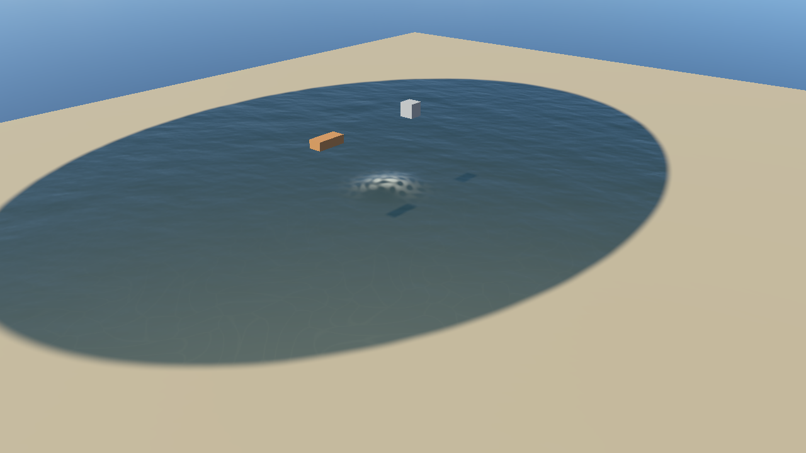
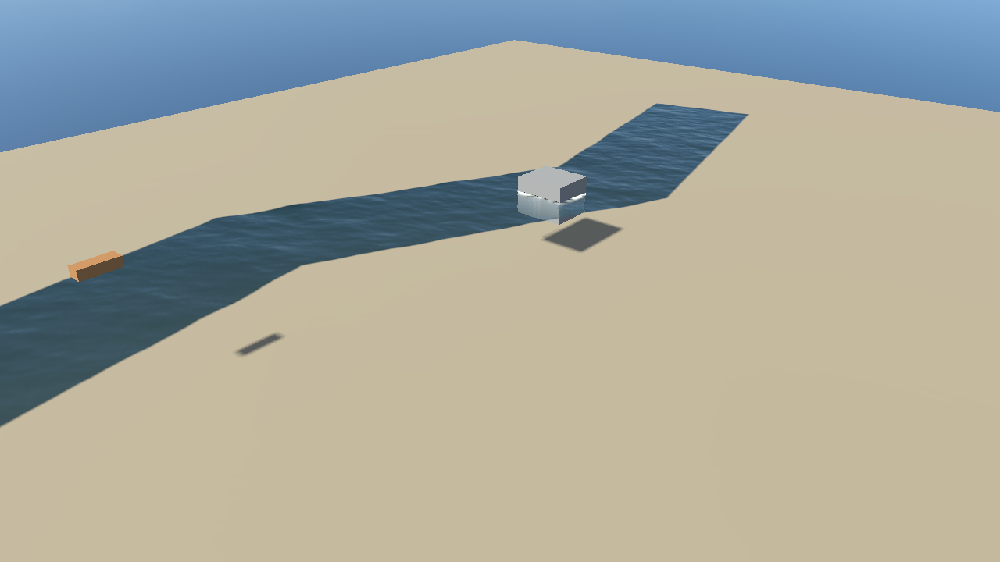
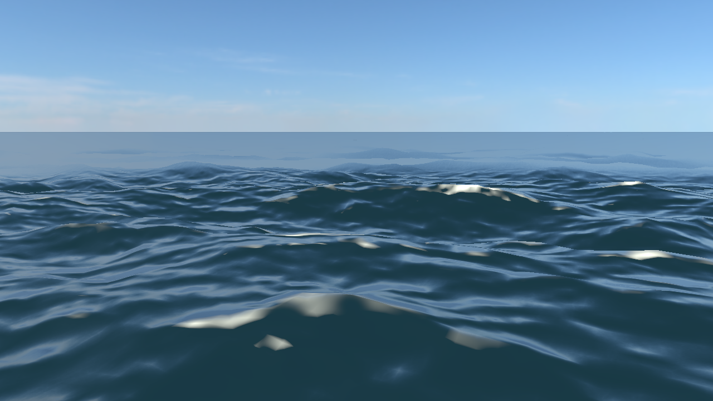

# Eau FFT : océan, lac et rivière

Le composant **VB FFT Water** est le socle commun des trois prefabs. Son nom C# `VoidBreach.Ocean.VBFFTOcean` est conservé pour les scènes déjà créées. Les anciens prefabs Gerstner supprimés ne sont pas rétablis.

Le module d'interactions universelles GPU, ses réglages, limites et résultats de validation sont décrits dans [FFTInteractions.md](FFTInteractions.md).

La passe d'optimisation du 25 octobre conserve la précision du rendu et réduit le travail CPU de flottabilité et plusieurs lectures/calculs du matériau. Protocole, mesures et compromis du cache physique : [OceanOptimization.md](OceanOptimization.md).

| Prefab | Usage | Scène de démonstration |
| --- | --- | --- |
| `water/prefabs/fft_ocean.prefab` | Mer à horizon étendu ; placer l'objet au niveau de la mer. | `water/scenes/fft_ocean_showcase.scene` |
| `water/prefabs/fft_lake.prefab` | Plan d'eau elliptique, vagues calmes, fond fini et caustiques. | `water/scenes/fft_lake_showcase.scene` |
| `water/prefabs/fft_river.prefab` | Ruban éditable par points, largeur, dénivelé et courant. Augmenter `Current Speed`, `Wave Height` et `Foam` pour des rapides. | `water/scenes/fft_river_showcase.scene` |

`water/scenes/fft_physics_showcase.scene` sert aux vérifications en Play : bois flottant, bloc dense et personnage de test. Dans les scènes de démonstration, les objets physiques commencent au-dessus de l'eau et ne tombent qu'en Play.

Tous les nouveaux prefabs utilisent `water/materials/fft_ocean.vmat` et la même variante FFT du shader partagé. Le lac accepte `Size` et le yaw. La rivière accepte jusqu'à 64 `River Points` en coordonnées locales ; éviter les points confondus, les virages en épingle et les auto-intersections. Les points décrivent un ruban polygonal ; en ajouter pour arrondir un virage. Le pitch, le roll et l'échelle du parent ne servent pas à redimensionner l'eau : utiliser les réglages du domaine. L'océan reste horizontal et aligné au monde.

## Réglages

| Réglage | Effet |
| --- | --- |
| Wind Speed | Vent en m/s, de 1 à 25 ; déplace le pic du spectre. |
| Wind Direction | Direction dominante du vent sur le plan XY, indépendante de la houle. |
| Wind Diffusion | Dispersion angulaire ; 1 distribue l'énergie dans toutes les directions. |
| Wind Variation / Period | Variation lente du vent, en degrés et secondes. Les phases et vecteurs d'onde restent continus. |
| Swell Amount / Direction / Wind Speed | Énergie et direction de la houle indépendante ; `Swell Amount` est une fraction d'énergie, pas d'amplitude. |
| Wave Height | Hauteur significative Hs en mètres, soit quatre écarts types ; ce n'est pas une amplitude maximale. Valeur initiale : 1,2 m. |
| Choppiness | Déplacement horizontal et compression des crêtes ; 0 désactive le déplacement horizontal. |
| Speed | Vitesse de l'animation ; 0 fige les vagues. |
| Seed | Reproduit un spectre donné. |
| Resolution | Subdivisions du maillage, indépendantes de la résolution FFT. Valeur initiale : 160. |
| Grid Spacing | Pas du maillage proche en unités Source ; 32 par défaut. Réduire à 16 pour une caméra très proche de l'eau. |
| Horizon Distance | Distance du bord de la surface ; adapter aussi le ZFar de la caméra. |
| Clarity / Roughness / Foam | Absorption de la lumière, rugosité et intensité de l'écume. |
| Debug View | Normales, écume, réflexion ou épaisseur pour régler l'éclairage. |
| Native Physics / Fluid Density | Active le volume et règle sa densité en kg/m³ ; 1000 pour l'eau. |
| Linear Drag / Angular Drag | Traînée et amortissement angulaire transmis à la physique native. |
| Current Speed | Courant en unités Source/s ; suit le ruban en rivière et `Wind Direction` ailleurs. |
| Depth | Profondeur du domaine physique en unités Source. |
| Physics Modes | Nombre de paires de modes FFT retenues pour les requêtes CPU, 128 par défaut. |
| Interactions / Interaction Cell Size | Active les deux grilles locales. Pas proche de 8 unités par défaut ; pas éloigné huit fois plus grand. |
| Interaction Wave Speed / Damping | Vitesse de propagation et dissipation des impacts. |
| Caustic Strength / Scale / Depth | Intensité, taille et atténuation en profondeur des caustiques. |
| Underwater Effects | Installe un effet de caméra sous-marine commun à la scène, sans empiler un effet par étendue. |

Un vent de 5 à 7 m/s et une hauteur de 0,3 à 0,6 m donnent une mer calme ; les valeurs par défaut donnent une mer modérée. Pour une mer agitée, essayer 14 m/s, 2 m et une choppiness de 1. Les deux réglages vent/hauteur sont indépendants pour faciliter la direction artistique.

## Simulation et coût

- Deux cascades de **128 × 128**, couvrant des tuiles de **256 m et 32 m**, avec des bandes de fréquences disjointes séparées à 16 m de longueur d'onde.
- Deux sources **JONSWAP**, vent local et houle indépendante, sont construites sur CPU uniquement quand leurs réglages changent. Leurs hauteurs significatives sont pondérées par la racine de leur fraction d'énergie. La dispersion garde de l'énergie dans les directions transversales.
- La variation lente du vent repondère les amplitudes sans tourner les vecteurs d'onde ni réinitialiser leurs phases. Le vent et la houle sont combinés **avant l'IFFT**, sans doubler les transformées. Le courant reste indépendant de cette variation.
- Trois dispatchs GPU par mise à jour rendue : évolution temporelle, IFFT des lignes, IFFT des colonnes et assemblage. Les vues suivantes réutilisent ces résultats. Quatre transformations complexes sont empaquetées en deux buffers `float4`, produisant huit champs réels : hauteur, déplacement XY, pentes XY et dérivées horizontales.
- Calcul radix-2 en mémoire de groupe ; barrières entre les passes ; aucune lecture GPU vers CPU et aucune reconstruction de maillage par image.
- Environ **4 Mio GPU** pour la FFT par étendue, plus **1,63 Mio GPU** pour les deux grilles interactives à 128² (états ping-pong, sorties, cartes de domaine et sources). Les spectres CPU conservés représentent 1 Mio et les grilles CPU environ 328 Kio. Ces chiffres excluent maillages, volumes de collision, matériaux, particules et sondes. Le maillage d'océan initial compte **51 200 triangles** ; les surfaces finies et les rubans ont leurs propres dimensions.
- Maillage proche régulier, extension progressive vers l'horizon, filtrage des petites cascades à distance et rugosité corrigée par les dérivées des normales. L'atlas est échantillonné avec interpolation périodique pour éviter les coutures entre cascades.
- Écume issue du déterminant du Jacobien horizontal et des impacts, réfraction avec rejet des objets au premier plan, absorption en profondeur et éclairage/réflexions du moteur. Les caustiques procédurales sont modulées par la compression FFT et les perturbations. Leur calcul est évité sans fond visible ou à profondeur excessive. Les cascades devenues invisibles ne sont plus échantillonnées.
- La sonde du prefab exclut le tag `water_surface` et capture l'environnement à l'activation (`OnEnabled`), sans recaptures périodiques. Pour un ciel changeant, configurer volontairement une mise à jour avec un budget adapté.

La mémoire et le nombre de passes ci-dessus sont calculés à partir de l'implémentation. Aucun temps GPU ni objectif de FPS n'est garanti sans mesure dans la scène cible. Le coût à l'écran dépend particulièrement de la surface couverte par l'eau et des captures de réflexion. Pour un éclairage fixe, préférer une sonde précalculée configurée dans l'éditeur.

## Physique native et nage

Chaque étendue génère un `ModelCollider` trigger et un **`Sandbox.WaterVolume`** sous un enfant non sauvegardé. L'océan utilise un grand volume fini, le lac une enveloppe elliptique convexe à 32 côtés, et la rivière plusieurs prismes réunis dans **un même collider**, pour éviter une application de flottabilité par segment.

Le moteur expose une surface plane par `WaterVolume`. `VBFluidVolumeBridge` inscrit donc les rigidbodies dans `VBFluidBody` et les exclut du traitement plan global avec le tag réservé `vb_fluid_managed`. L'adaptateur appelle **`Rigidbody.ApplyBuoyancy` natif une seule fois par corps**, avec les paramètres du `WaterVolume` et un plan tangent échantillonné sur la FFT. Les surfaces qui se chevauchent sont départagées par priorité puis hauteur. Le tag est retiré à la sortie/désactivation. Les proxies réseau n'appliquent pas de force.

Les objets physiques n'ont pas besoin d'un composant de flottabilité posé à la main. Le composant historique `VBWaterBuoyancy` évite les surfaces déjà gérées nativement ; ne pas ajouter un second `WaterVolume` manuel au même endroit. Un `Rigidbody` propriétaire et un collider physique restent nécessaires.

Les requêtes utilisent les coefficients du même spectre FFT, avec inversion du déplacement horizontal et vélocité des vagues. Pour réduire le coût, elles retiennent les modes les plus énergétiques et filtrent les longueurs d'onde inférieures à 2 m. `PhysicsRetainedEnergy` et `vb_fft_water_check` donnent la fraction d'énergie retenue à la construction des sources ; cette valeur varie avec le profil et le budget de modes. L'inversion calcule uniquement le déplacement ; normales et vitesses sont évaluées au point final. La flottabilité ne correspond donc pas à chaque petit pli du rendu. Un grand navire nécessiterait un échantillonnage de coque plus détaillé que le plan tangent par corps utilisé ici.

Le prefab du personnage emploie **`VBMoveModeSwim`**, dérivé du mode de nage natif : les contrôles et animations restent natifs, tandis que l'entrée/sortie dépend de l'immersion FFT échantillonnée et que le courant s'ajoute au déplacement. Le personnage est exclu de la poussée des rigidbodies pendant que son mode de mouvement gère la nage. Les effets FFT sont maintenant émis par le suivi universel des corps/colliders et ne nécessitent aucun interactor propre au contrôleur. `VBWaterInteractor` conserve l'exclusion de flottabilité du personnage, les compteurs historiques et les effets des anciennes surfaces.

Les effets sous-marins utilisent maintenant cette surface commune. Ils s'installent automatiquement une fois par scène ; décocher `Underwater Effects` sur toutes les étendues permet de gérer les effets de caméra soi-même.

## Impacts et simulation de surface extensible

`GpuFluidSurfaceField` propage le champ visuel sur deux grilles GPU, **128² par défaut**, avec ping-pong hauteur/vitesse/mousse, transport par courant, masque des berges et sous-pas CFL. Une passe de résolution produit les hauteurs et gradients effectivement utilisés par les sommets et normales FFT. `FluidSurfaceField` conserve deux approximations CPU de **64²** pour les requêtes physiques sans lecture GPU. Les impulsions et paramètres sont partagés ; les champs CPU et GPU ne sont pas identiques.

Avec le pas proche de 8 unités, les zones couvrent **512 × 512 unités** (environ 13 m de côté) et **4096 × 4096 unités** (environ 104 m). Elles suivent la caméra, ou le point le plus proche de l'étendue quand la caméra est à l'extérieur. Le recentrage conserve les échantillons communs et le mélange des deux niveaux tient compte de son gradient. Le shader échantillonne les perturbations aux positions déplacées par la FFT pour les garder sous le contact.

Les impacts hors de ces zones utilisent le repli historique borné à huit anneaux analytiques dans les normales, avec les particules d'éclaboussure ; ils n'ont pas de déplacement géométrique local. La rivière utilise une carte GPU de courant issue des tangentes du ruban ; l'approximation CPU garde un courant uniforme local.

La simulation avance à **30 Hz configurables**, avec au plus deux pas de rattrapage et un retard GPU limité à 100 ms. Les buffers d'événements et cartes de domaine remplacent les transferts continus de hauteurs CPU. Les champs inactifs dorment ; le GPU utilise une durée de repos conservatrice calculée à partir de l'amortissement, sans lecture de son énergie.

Le suivi universel produit entrées, sorties et sillages sans composant d'effets par entité. Les tirs de `VBCombatWeapon` utilisent l'origine de bouche lorsque `ShotEffect.Origin` est nul, conformément au contrat natif. Les pellets `NoEvents` gardent leurs impacts. Les intersections incluent les tirs rasants et les crêtes déplacées, avec une recherche bornée. Les impulsions sont limitées à **48 par tick par défaut, 64 au maximum**. Entrées, sorties et impacts ponctuels réutilisent les particules s&box depuis un pool de **256 particules maximum par étendue**, sans collisions individuelles.

Points d'extension utilisables depuis le code :

```csharp
// Coordonnées monde : impact ponctuel, pluie, explosion ou émetteur personnalisé.
water.ApplySurfaceImpulse( position, radius: 48f, strength: 70f );
water.EmitSurfaceImpact( position, 48f, 100f, VoidBreach.Water.FluidImpactKind.Explosion );
VoidBreach.Water.FluidImpacts.Splash( Scene, position, 48f, 70f );
VoidBreach.Water.FluidImpacts.Segment( Scene, start, end );

// Solveur indépendant : coordonnées 2D dans le plan choisi par l'appelant.
var field = new VoidBreach.Water.FluidSurfaceField();
field.MoveTo( Vector2.Zero, 32f );
field.SetBlocked( 32, 32, true );
field.Impulse( new Vector2( 100, 100 ), 48f, 70f );
field.Step( 0.02f, new Vector2( 30, 0 ) );
```

Ce socle permet de réutiliser les impulsions, masques et paramètres de densité/amortissement pour d'autres surfaces. Il s'agit d'une **simulation de surface en 2D**, pas d'un solveur volumétrique Navier–Stokes/SPH. Les gouttes sont des particules visuelles ; il ne simule pas le mélange eau/sang, la rupture de surface ou un kawoosh tridimensionnel. Ces effets pourront réutiliser l'API de forçage et ajouter un solveur/rendu spécialisé. Le masque d'obstacles de la grille est exposé par son API ; les rochers intérieurs ne sont pas automatiquement rasterisés comme des obstacles d'écoulement.

## Limites de rendu et réseau

La phase des vagues utilise une horloge issue de l'hôte sur les objets réseau ; les prefabs sont configurés en mode `Object`. Une ancienne instance laissée en `Never` continue à s'animer localement. Les paramètres du spectre doivent être identiques sur les pairs. Avec `ReplicateInteractions`, l'hôte diffuse les contacts automatiques en lots d'événements ; chaque client reconstruit son champ. Les effets explicites locaux gardent leur chemin existant et l'API `EmitReplicatedSurfaceImpact` permet une émission commune depuis l'hôte. Le champ complet n'est pas répliqué ni déterministe entre machines. La validation ci-dessous est locale ; elle ne constitue pas un test multijoueur ou de migration d'hôte.

Les cascades restent périodiques dans l'espace et leur phase FFT boucle sur 256 secondes. Il n'y a pas de solveur de déferlement côtier, de réflexion planaire, de SSR propre à l'eau ou de caustiques injectées comme éclairage réel dans le monde. Les caustiques et la réfraction utilisent la profondeur visible de la caméra. Le rendu conserve deux cascades et ne reprend pas les moments LEAN ni le ciel atmosphérique du dépôt de référence.

## Vérification

La validation des 24 et 25 octobre 2026 comprend **435 055 contrôles numériques** (427 907 FFT et 7 148 surface/physique/maillage), les essais génériques dans le moteur, le vrai véhicule avec tourelle et une capture des triangles déformés sans écume. Le collecteur GPU final a passé dix cycles Play/arrêt avec zéro lot restant après chaque arrêt et sans erreur native de texture détectée, puis 45 secondes de nettoyage supplémentaire. Le coût mesuré des contacts immobiles passe de 6,22–7,13 ms à 0,38–0,82 ms, à maillage inchangé. Les réglages, résultats et limites de stabilité sont détaillés dans [FFTInteractions.md](FFTInteractions.md). Les résultats Play historiques ci-dessous restent ceux de leur version datée.

`Tests/Ocean/run_native_water_interactions.ps1 -EditorPid <pid>` utilise désormais l'éditeur déjà ouvert et sa copie Play : tir natif à origine implicite, pellet `NoEvents`, entrée/sortie du prefab personnage, nage, énergie de surface et pool de particules. Il retire ses outils temporaires et ne sauvegarde pas la scène. Les anciens bancs de captures dédiés restent distincts ; consulter leur script avant exécution. Les mesures comparatives du 25 octobre dans `basic_example` montrent un gain CPU avec le raffinement conservé ; elles ne garantissent pas un niveau de FPS sur toutes les scènes.

`Tests/Ocean/run_fft_checks.ps1` vérifie le spectre de production, son déterminisme, les coefficients conjugués, la hauteur significative, les modes DC/Nyquist, la boucle temporelle et les huit champs spatiaux empaquetés face à des sommes de Fourier directes.

Validation du **18 octobre 2026** : **432 021 contrôles numériques réussis** (427 901 FFT et 4 120 pour la grille interactive, les domaines et les requêtes physiques). La compilation C# réussit avec les avertissements préexistants du projet. Les trois formes ont été rendues dans s&box en 1280 × 720, avec leur volume natif valide et sans erreur du shader pendant ces essais.

Essais réels en Play dans la scène de physique : le bois de 450 kg reste à environ Z = 6 unités et dérive à environ `(28,7 ; 8,5)` unités/s, pour un courant de 30 unités/s orienté `(1 ; 0,3)`. Le bloc de 12 000 kg descend sous Z = −130. Le personnage déclenche le mode natif de nage avec environ 94 % d'immersion ; sa vitesse de nage au repos comprend bien le courant. La sortie de l'eau rend un score de nage négatif. La désactivation libère le volume, la réactivation le recrée, et le flotteur de rivière se déplace depuis X = −900 jusqu'à environ X = 184 en suivant le courant du ruban. Les contacts produisent une énergie de perturbation non nulle et finie.

`Tests/Ocean/run_native_fluid_checks.ps1` permet de rejouer les captures et ces essais dans un éditeur séparé masqué. Le script installe temporairement le banc de test dans `Editor/`, le limite au processus portant son argument de validation, puis retire ce fichier et ferme uniquement le processus créé. Les captures et le journal sont écrits dans `tmp/`. Lancer ce test depuis un terminal disposant de l'accès à l'installation s&box.

Commandes utiles : `vb_fft_water_check` affiche les volumes, courants, horloges, taux d'énergie FFT retenue, corps suivis et niveaux d'immersion des nageurs. Les essais natifs sont locaux et ne fournissent pas de mesure de temps GPU.





Validation initiale du 17 octobre 2026 : **427 901 contrôles réussis**, compilation C# et shaders réussie, capture native de l'océan et vérification ponctuelle des déplacements GPU non nuls et finis. Les lectures GPU de validation sont réservées au banc de test, et ne sont pas utilisées par les requêtes physiques de production.



Cette capture valide le rendu d'un point de vue ; elle ne remplace pas un profil GPU ni une inspection temporelle des transitions de grille et du scintillement dans la scène de jeu cible.

## Référence

L'adaptation utilise les contrats s&box de [ComputeShader](https://sbox.game/api/Sandbox.ComputeShader/), [Graphics.UavBarrier](https://sbox.game/api/Sandbox.Graphics/UavBarrier) et [ParticleEffect](https://sbox.game/dev/doc/rendering/effects/particle-effect/). L'organisation houle + interactions locales est éclairée par la [documentation Crest](https://crest.readthedocs.io/en/4.21.4/user/waves.html) et par le [sous-système d'interactions Unreal](https://dev.epicgames.com/documentation/unreal-engine/API/Plugins/WaterAdvanced/UShallowWaterSubsystem). Aucun code de ces deux systèmes n'est copié.

L'architecture de la FFT et l'empaquetage des champs sont adaptés de [Noniv/web-ocean](https://github.com/Noniv/web-ocean), sous licence MIT. La simulation s&box conserve deux cascades et un spectre plus simple. La notice originale est conservée dans `Docs/ThirdParty/web-ocean-LICENSE.txt`.
