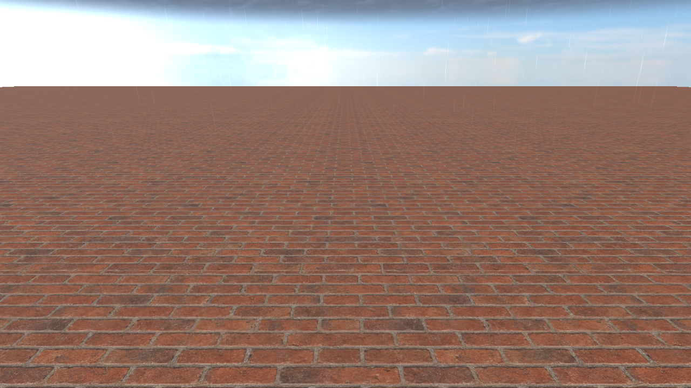

# Précipitations

Pluie générale sur la carte, avec gouttes proches détaillées, pluie distante répartie dans le monde, vent des nuages, abris physiques et petites éclaboussures. Les matériaux sont de vrais **ShaderGraphs s&box**, avec leurs shaders générés. Les nuages volumétriques conservent leur rendu HLSL existant.

## Installation

Ouvrir `environment/scenes/rain_showcase.scene` pour voir la pluie et un abri avec colliders. Déposer une seule instance de `environment/prefabs/weather_rain.prefab` dans une scène : elle contient météo, nuages, volume de post-traitement infini et précipitations. Si la scène utilise déjà `volumetric_clouds.prefab`, ajouter simplement **VB Precipitation** à son objet et lui assigner son **VB Cloud Weather**, ou remplacer cette instance par le nouveau prefab. Éviter deux couches de nuages superposées.

La caméra doit utiliser une projection perspective, avec **Enable Post Processing** pour les nuages. Les toits et murs doivent avoir des colliders. Les objets marqués `rain_passthrough` ne bloquent pas la pluie ; la liste **Ignore Tags** est configurable. Joueurs, NPC, debris et triggers sont ignorés par défaut. Retirer les tags de cette liste si ces objets doivent servir d'abri.

Le nouveau prefab démarre avec **Rain Intensity = 0.85**. Le prefab historique reste sec par défaut.

## Pluie générale et déluge tropical

Sur **VB Cloud Weather**, laisser **Rain Distribution = Everywhere** (défaut) : la pluie s'applique à toutes les régions de la carte et forme une couche nuageuse continue. Le mode **CloudBanks** conserve l'option de bancs localisés avec des trouées sèches.

**Rain Intensity** va désormais de **0 à 10** : 0 sec, 1 averse, 4 forte pluie, **8–10 pluie diluvienne**. Cette intensité augmente les gouttes proches et distantes. Pour un déluge de jungle, utiliser par exemple 8, une couverture de 0.95, une densité nuageuse de 1.5 et le vent souhaité. Les abris restent actifs.

Le prefab **`environment/prefabs/weather_monsoon.prefab`** fournit directement ce réglage à intensité 8. Utiliser une seule instance météo par scène, en remplacement du prefab de pluie ordinaire.

Sur **VB Precipitation**, **Distant Rain** est activé par défaut. **Distant Distance = 24000** étend la pluie visible au-delà du rayon de détail de 700 unités ; cette distance monte jusqu'à **100000** pour les cartes plus grandes. En jeu elle est bornée par le plan lointain de la caméra. La caméra libre de l'éditeur est suivie indépendamment de la caméra sauvegardée dans la scène.

Les trajectoires distantes se répartissent dans deux grilles ancrées au monde, avec une résolution plus fine près de la vue. Elles sont remplies et renouvelées progressivement dans le budget physique : attendre quelques secondes après l'activation ou une grande téléportation pour obtenir le champ complet. **Distant Vertical Range** adapte la tranche visible aux cartes avec de grandes différences d'altitude.

## Réalisme, continuité et impacts

Les gouttes proches et distantes sont réparties dans toute la surface de leurs cellules, avec des phases indépendantes et continues. Le nombre de gouttes par cellule est distribué équitablement : atteindre le plafond ne supprime pas les dernières cellules d'un côté de la vue. Les grilles se déplacent par recyclage des seules cellules de bord, en conservant les coordonnées du monde. Cela remplace les anciens départs aléatoires en petits paquets, qui pouvaient donner des coups de douche localisés.

Le matériau transmet la couleur de la scène et déforme localement son image comme une petite lentille d'eau. Les reflets restent liés à la lumière déjà visible dans le décor. **Refraction Pixels** règle le déplacement (1.25 pixel par défaut), **Optical Opacity** son mélange (0.8) et **Light Scattering** les reflets (0.3). La profondeur rejette les échantillons d'un mur ou d'une porte situés devant la goutte. L'effet reste porté par la géométrie visible de pluie, avec une copie GPU de couleur partagée par les deux matériaux pour chaque vue.

Les impacts sur sol dur ont été refaits : petites empreintes humides irrégulières, qui assombrissent brièvement la texture existante, et microgouttes balistiques de moins de 0.12 seconde. Il n'y a plus d'anneau blanc systématique. **Splash Density**, **Splash Size** et **Splash Lifetime** règlent respectivement leur nombre, leur taille et leur durée ; augmenter la densité conserve des impacts petits, plus proches de la pluie réelle qu'un agrandissement des sprites.

Les points de contact avec le sol sont vérifiés séparément, puis réutilisés pour plusieurs impacts déphasés. Leur nombre suit l'intensité de l'averse. Ce mouillé est une approximation visuelle temporaire : la rugosité des matériaux du niveau, les réflexions globales et l'accumulation de flaques ne sont pas modifiées.

## Météo et transitions

Sur **VB Cloud Weather**, `Coverage`, `Density`, `Wind` et `RainIntensity` sont les consignes. Un couvert important peut rester sec. Une demande de pluie, même faible, fournit une couverture et une densité minimales via **Rain Cloud Coverage** et **Rain Cloud Density**. `CurrentCoverage`, `CurrentDensity`, `CurrentWind` et `Precipitation` donnent les valeurs évaluées.

Depuis le code de l'hôte :

```csharp
// Installer des nuages puis augmenter progressivement la pluie sur 15 secondes.
weather.SetWeather( 0.8f, 1.4f, 0.9f, new Vector2( 180, 60 ), 15 );

// Déluge tropical sur toute la carte.
weather.RainDistribution = VBRainDistribution.Everywhere;
weather.SetWeather( 0.95f, 1.5f, 8, new Vector2( 180, 60 ), 15 );

// Arrêter la pluie tout en gardant un ciel couvert.
weather.SetWeather( 0.85f, 1.2f, 0, new Vector2( 80, 20 ), 12 );

// Revenir au beau temps.
weather.SetWeather( 0.15f, 0.8f, 0, new Vector2( 40, 10 ), 30 );
```

La transition utilise l'horloge de scène partagée et des extrémités synchronisées. Les nuages se forment avant l'apparition des gouttes. Le déplacement des nuages intègre la transition de vent pour éviter un saut du motif. Changer directement les propriétés dans l'inspecteur applique les consignes ; utiliser `SetWeather` pour une transition continue, notamment du vent. Les changements directs de graine ou de taille du bruit peuvent toujours déplacer les motifs.

## Nuages, abris et vent

En mode **Everywhere**, le même champ volumétrique utilisé par le ciel et les ombres reçoit un fond de densité nuageuse continu pendant la pluie. Le masque de pluie peut alors valider cette couche sans lire les bruits détaillés pour chaque pixel. Un ciel couvert sec conserve ses formes habituelles.

En mode **CloudBanks**, le matériau consulte quatre hauteurs du **même champ de densité détaillée** que les nuages : textures, graine, couverture, érosion, horloge et déplacement identiques. Les points sont décalés à contre-vent selon la vitesse de chute. Une goutte ou une éclaboussure est masquée si ces échantillons ne trouvent pas de nuage. Cet échantillonnage parcimonieux peut laisser une petite masse nuageuse sèche. L'évaluation reste sur le GPU, sans lecture GPU → CPU ni nouvelle texture de bruit.

Chaque cellule proche utilise une boîte balayée depuis la base nuageuse jusqu'au premier obstacle. Les gouttes déphasées occupent l'espace vérifié, dans une grille de 12×12, 16×16 ou 20×20 selon la qualité. Leur nombre augmente sans ajouter une trace par goutte. Depuis un bâtiment, on continue à voir la pluie à l'extérieur.

Les cellules distantes utilisent aussi une boîte balayée couvrant leur surface. Les gouttes s'y répartissent latéralement, au lieu de former une file verticale étroite. **Shelter Refresh Seconds**, 2 s par défaut, pilote le renouvellement dans le même budget global que les cellules proches et les contacts au sol. Les empreintes vérifiées incluent la largeur des traînées.

`WindInfluence` règle l'inclinaison avec le même vent XY que les nuages. Les cellules prennent le vent actualisé lors de leur renouvellement. Les contacts d'impact sont tracés sur tout le trajet exposé jusqu'à la vraie surface, puis les petites empreintes sont alignées sur sa normale.

Les abris statiques sont protégés. Les obstacles mobiles sont pris en compte au renouvellement du cache ; une cellule non renouvelée est masquée après l'intervalle plus 2 s. La disparition du collider accélère son renouvellement et un changement de hauteur de contact masque les anciens impacts. Le balayage est conservatif : un toit peut assécher un peu trop de terrain dans sa cellule, surtout en rendu distant. Les vitres avec collider bloquent la pluie ; les géométries sans collision doivent recevoir un collider si elles servent d'abri.

## ShaderGraph

- `environment/shaders/vb_rain_drop.shdrgrph` : traînée douce, réfraction, transmission du décor et masque nuageux.
- `environment/shaders/vb_rain_splash.shdrgrph` : empreinte humide irrégulière et microprojections réfractives.
- **VB Rain Cloud Mask**, dans la palette `Void Breach/Weather`, est un petit nœud C# d'éditeur. Il appelle `vb_rain_cloud_mask.hlsl`, qui réutilise `vb_cloud_density.hlsl`. Son aperçu isolé renvoie 1 ; la météo est liée au rendu réel par C#.

Les graphes restent éditables, avec le nœud natif **Scene Color** et les nœuds **VB Rain Optics**, **VB Rain Impact Mask** et **VB Rain Cloud Mask**. Les shaders générés sont fournis pour le jeu exporté ; aucun code d'éditeur n'est nécessaire au runtime. Les matériaux sont translucides. Leur modèle de transmission reprend la lumière de l'image de scène ; il ne constitue pas une simulation optique complète ni un matériau PBR de goutte volumique.

Références moteur : [ShaderGraph](https://sbox.game/dev/doc/rendering/shader-graph/), [nœuds C#](https://sbox.game/dev/doc/rendering/shader-graph/custom-nodes/).

## Budgets et réseau

| Qualité locale | Gouttes proches max. | Gouttes distantes max. | Colonnes distantes | Impacts max. | Traces/s max. | Traces/frame max. |
| --- | ---: | ---: | ---: | ---: | ---: | ---: |
| Off | 0 | 0 | 0 | 0 | 0 | 0 |
| Low | 768 | 2048 | 128 | 192 | 180 | 8 |
| Medium | 2048 | 8192 | 288 | 512 | 420 | 16 |
| High | 4096 | 16384 | 512 | 1024 | 800 | 24 |

Les tokens de traces sont plafonnés à une frame ; le renouvellement distant prend au plus la moitié des tokens disponibles. Proche et contacts au sol partagent le reste. Une frame lente ne déclenche pas une rafale de rattrapage. Gouttes proches et distantes partagent un lot, les empreintes et microgouttes un second : **au plus deux appels de dessin et une copie GPU de couleur par vue**, sans GameObject, Rigidbody ou objet réseau par goutte. La cible de couleur est rendue au pool après les dessins. Les listes réservent leur capacité au premier besoin sur un client puis réutilisent cette mémoire ; le serveur dédié ne réserve pas ces tableaux de particules et de contacts. Les textures de nuages sont partagées. Ces plafonds ne constituent pas une mesure de coût GPU ; profiler la qualité choisie sur la carte cible.

Seules les consignes météo et les données d'une nouvelle transition sont répliquées avec `[Sync(FromHost)]`. Aucun RPC par goutte, aucune texture ni liste de particules n'est envoyée. Chaque client crée ses détails visuels autour de sa caméra ; leurs positions aléatoires ne sont pas synchronisées. **Quality** est un réglage local. Le serveur dédié ignore entièrement traces et géométrie de pluie. Le prefab doit conserver **Network Mode = Object**.

`VBCloudWeather` porte les consignes et l'évaluation des transitions. `VBPrecipitation` reste un seul composant, réparti en fichiers partiels pour les cellules proches, distantes et les impacts ; état de caméra, horloge et budget de traces sont communs. Les contacts utilisent directement l'indice de leur cellule proche. L'intensité et les réglages constants sont évalués hors des boucles de gouttes. Aucun gestionnaire réseau ou système de particules supplémentaire n'a été ajouté.

La désactivation du composant, de la météo, de l'aperçu ou de la qualité libère l'objet de rendu et vide les effets. Une téléportation importante purge les anciennes gouttes proches et renouvelle progressivement le champ distant. Les caméras orthographiques et les vues situées au-dessus de la base nuageuse sont ignorées. En jeu, le champ suit `Scene.Camera` ; dans l'éditeur, il suit la dernière vue effectivement rendue. Les caméras secondaires partagent le champ, sans simulation supplémentaire par vue.

Cette version fournit les petits impacts demandés. Elle ne modifie pas la rugosité des matériaux du niveau et ne laisse pas de decal de sol trempé persistant.

## Validation

La passe initiale a été vérifiée sur le moteur **26.10.13c**, la passe de réalisme sur **26.10.27b**. Les deux shaders de pluie sont régénérés et compilés nativement. `Tests/Environment/RainRegression.csx` conserve ses 30 contrôles de base. `RainCoverageRegression.csx` ajoute 15 contrôles : preset de déluge, champ à 24000 unités, trajectoires au-delà de 10000, déluge via API, augmentation réelle des deux densités, pixels de pluie distante sans gouttes proches, traversée de carte de 36000 unités, trajectoires ancrées au monde, budgets inchangés, toit couvrant les deux couches, vue libre éloignée de 35000 unités, retour optionnel aux bancs et nettoyage. `CloudRegression.csx` couvre les 25 contrôles historiques des nuages.

`RainRealismRegression.csx` contrôle aussi la continuité dans les quatre quadrants exposés au fil du temps, la densité des contacts au sol, les pixels d'impact isolés sur un sol texturé, l'effet de transmission/réfraction et les plafonds de dessin/copie. Les captures isolées servent à inspecter l'aspect, pas à annoncer un temps GPU ou un gain de FPS.

Les contrôles de configuration et d'interpolation réseau ne remplacent pas une session à deux clients : arrivée tardive, migration d'hôte et coût réseau réel restent à mesurer. Aucun temps GPU ou gain de FPS n'est revendiqué à partir des captures isolées.

`Tools/CreateRainAssets.csx` régénère les deux graphes, shaders et matériaux via le compilateur natif. `Tools/CreateRainShowcase.csx` réécrit uniquement la nouvelle démonstration et le nouveau prefab ; il conserve les identifiants du prefab existant. Ne pas le relancer après personnalisation de ces assets pour un simple test : utiliser la régression.


